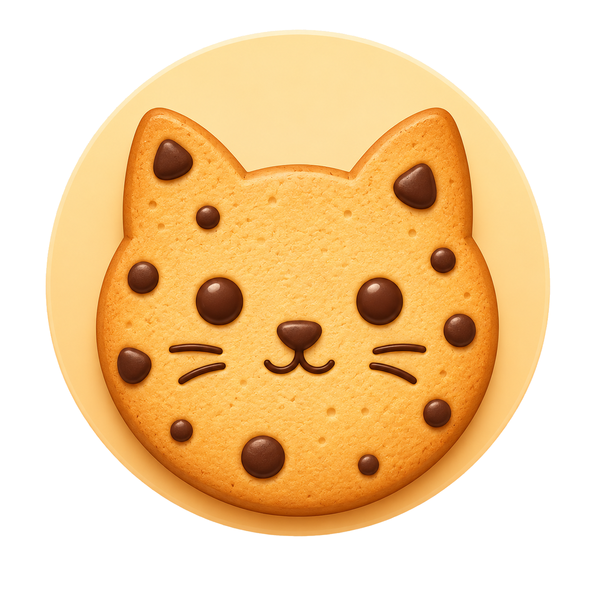

   
  
  <h1>Cocookies</h1>

<h3>A self-hostable recipe manager</h3>

## Features

- Multiple Users (can share recipes)
- Guest access: browse shared recipes read-only, no account needed
- Recipe Nutrition Info
- PDF Generation
- AI Import of recipes (from images, PDFs...)

And more

## Self-hosting

Copy `.env.example` to `.env`, set at least `JWT_SECRET`, and run `docker compose up -d`.
The app is served on port 8080. Configuration options are documented in
[backend/README.md](./backend/README.md#configuration). Databases from previous versions are
migrated automatically on start-up.

## Development

- Backend (Rust): `cd backend && cargo run` — see [backend/README.md](./backend/README.md)
- Frontend (Vue): `cd frontend && pnpm install && pnpm dev`

## About me

Check out my [other projects](https://github.com/mariinkys)

You can also help do this and more projects, [Buy me a Coffee](https://www.buymeacoffee.com/mariinkys)

## Copyright and Licensing

Copyright 2026 © Alex Marín

Released under the terms of the [GPL-3.0](./LICENSE)
